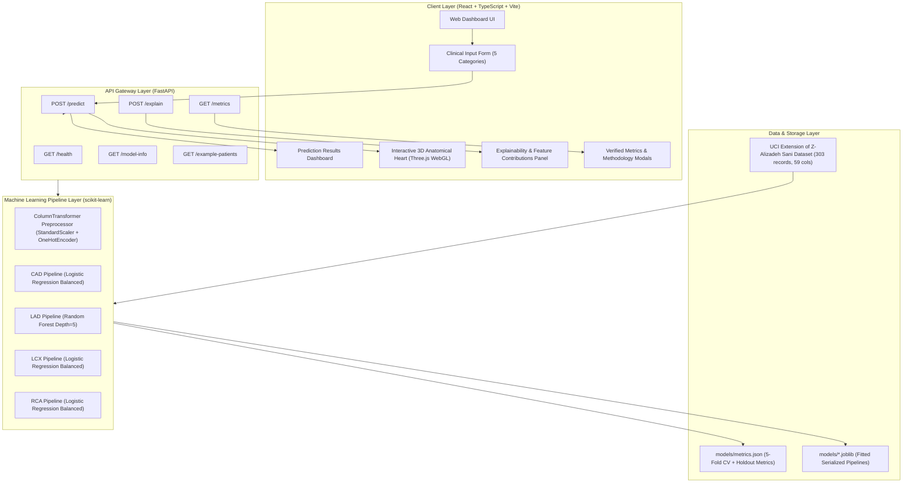

# CardioVista AI — Architecture & System Design

## 1. System Architecture Overview

CardioVista AI is architected with a decoupled full-stack design comprising a high-performance **Python FastAPI** backend powered by **scikit-learn** pipelines, and a modern **React + TypeScript + Three.js** interactive visualization frontend.

---

## 2. Component Breakdown

### 2.1 Backend Architecture (FastAPI & scikit-learn)
1. **`backend/app/main.py`**:
   - Application entrypoint configured with CORS middleware and endpoint routing.
   - Strict Pydantic v2 data validation with clinical range limits.
2. **`backend/app/model_loader.py`**:
   - `ModelManager` singleton providing thread-safe model inference, probability calibration, risk classification, and 3D shader color assignment.
3. **`backend/app/schemas.py`**:
   - Type-safe schemas with validation bounds matching clinical physiological boundaries.
4. **`backend/scripts/train_and_evaluate.py`**:
   - 5-Fold Stratified Cross-Validation and holdout testing script.
   - Enforces strict target-leakage isolation (`Cath`, `LAD`, `LCX`, `RCA` excluded from inputs).

### 2.2 Frontend Architecture (React, Vite, Three.js)
1. **`src/components/HeartVisualizer3D.tsx`**:
   - WebGL rendering pipeline utilizing Three.js.
   - Anatomical geometry modeling myocardial ventricles, atria, ascending aorta, pulmonary artery trunk, and coronary branches (LAD, LCX, RCA).
   - Dynamic shader emissive glow and color coding reflecting real-time predictions.
   - Rhythmic heartbeat pulsation animated according to patient pulse rate (PR).
2. **`src/components/ClinicalForm.tsx`**:
   - Tabbed input interface organized across Demographics, Symptoms/Exam, ECG, Labs, and Echo.
   - Automatic BMI calculation.
   - Benchmark case loader (Low-Risk, Isolated LAD, Multivessel CAD).
3. **`src/components/PredictionDashboard.tsx`**:
   - Primary CAD probability gauge, branch-specific stenosis cards, and risk badges.
4. **`src/components/ExplainabilityPanel.tsx`**:
   - Transparent feature-importance bar charts with clinical biomarker context.

---

## 3. Data Flow Workflow

1. **User Action:** The clinician or evaluator selects an illustrative benchmark case or enters clinical parameters in the frontend form.
2. **Validation:** Frontend and backend Pydantic models validate all 54 features against biological ranges.
3. **Inference Execution:**
   - Input vector is transformed through the fitted `ColumnTransformer`.
   - Four dedicated pipelines evaluate the input independently for CAD, LAD, LCX, and RCA.
4. **Response Assembly:** The backend packages predicted labels, continuous probabilities, vessel stenosis burden, and anatomical 3D color codes.
5. **Visualization Sync:**
   - Dashboard gauges update with risk percentages.
   - Three.js coronary vessels transition to corresponding status colors (Red: $\ge 50\%$ stenosis, Amber: borderline, Green: patent).
   - Heart pulsation frequency synchronizes with the patient's resting pulse rate.
